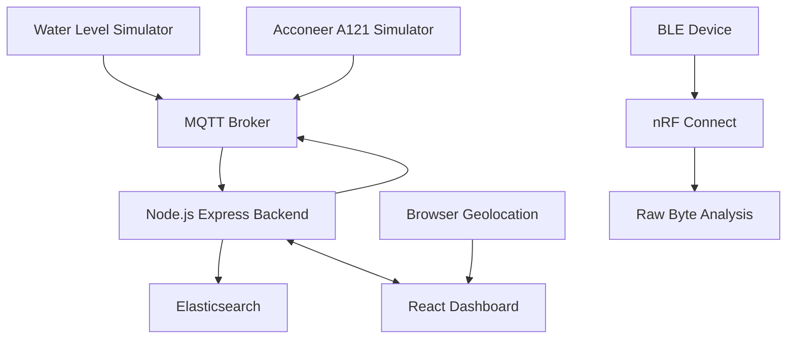

# AquaSense – IoT-Based Water Level Detection System


## 📌 Project Overview

AquaSense is a full-stack IoT-based Water Level Detection and Monitoring System developed as part of the Growth Tech India IoT training assignment.

The system provides real-time simulated water level monitoring, Bluetooth Low Energy (BLE) communication, raw byte data analysis, geographical location tracking, MQTT communication, and Elasticsearch integration.

The application uses React.js for frontend development and Node.js with Express.js for backend services.

Since physical Acconeer A121 hardware was unavailable, sensor readings were simulated using Node.js to demonstrate the IoT communication and monitoring workflow.

## 🎯 Project Objectives

- Monitor and visualize water level data.
- Understand Bluetooth Low Energy communication.
- Analyze and decode raw BLE characteristic data.
- Retrieve geographical location coordinates.
- Explore Acconeer A121 radar sensor configuration.
- Implement MQTT-based communication.
- Store and retrieve IoT data using Elasticsearch.
- Develop an interactive and responsive monitoring dashboard.

## ✨ Key Features

- Real-time Water Level Monitoring
- Interactive Water Tank Visualization
- Water Level Analytics and Trends
- BLE Device Monitoring
- Raw Byte Data Analysis
- Hexadecimal, Decimal and Binary Conversion
- Geographical Location Tracking
- Acconeer A121 Sensor Simulation
- MQTT Broker Integration
- Elasticsearch Data Storage
- Historical Data Monitoring
- Water Level Alerts
- Responsive User Interface

## 🛠️ Technology Stack

| Technology | Purpose |
|------------|---------|
| React.js | Frontend Development |
| Vite | Frontend Build Tool |
| CSS | User Interface Styling |
| JavaScript | Application Logic |
| Node.js | Backend Development |
| Express.js | REST API Development |
| MQTT | IoT Communication Protocol |
| Mosquitto | MQTT Broker |
| Elasticsearch | Data Storage and Retrieval |
| Bluetooth Low Energy | Device Communication |
| nRF Connect | BLE Testing |
| Acconeer Exploration Tool | Sensor Configuration |
| Visual Studio Code | Development Environment |
| Git and GitHub | Version Control |

## 🏗️ System Architecture



BLE characteristic data is analyzed separately and does not represent actual water level measurements.

## 📂 Project Structure

```text
GrowthTech_IoT_Training/
│
├── frontend/
│   ├── src/
│   │   ├── App.jsx
│   │   └── App.css
│   └── package.json
│
├── node-backend/
│   ├── server.js
│   ├── simulator.js
│   ├── acconeer-simulator.js
│   ├── elasticsearch.js
│   ├── task3-location.js
│   └── package.json
│
└── README.md
```

## 📋 Training Modules

### Task 1: BLE Connectivity

Bluetooth Low Energy communication was explored using the nRF Connect application and BLE-compatible devices.

Activities performed:

- BLE device scanning
- Device connection
- GATT service discovery
- Characteristic identification
- Raw data reading

### BLE Device Characteristics

| Parameter | Value |
|-----------|-------|
| Service | Telephony and Media Audio Service |
| Service UUID | 0x1855 |
| Characteristic | TMAP Role |
| Characteristic UUID | 0x2B51 |
| Raw Byte Data | 05 00 |

### Task 2: BLE Data Reading and Analysis

The received raw BLE data was converted into different numerical representations for analysis.

| Data Format | Value |
|-------------|-------|
| Raw Bytes | 05 00 |
| Hexadecimal | 0x05 0x00 |
| Decimal | [5, 0] |
| Binary | 00000101 00000000 |
| Little Endian | 5 |

The recorded BLE data represents Bluetooth role information and is not an actual water level measurement.

### Task 3: Device Location Tracking

The application supports geographical location tracking using the browser Geolocation API.

Features include:

- Latitude retrieval
- Longitude retrieval
- Manual location entry
- MQTT-based location transmission
- Elasticsearch location storage
- Historical location records

The coordinates represent browser-based or manually entered locations, not physical sensor GPS readings.

### Task 4: Acconeer A121 Sensor Setup

The Acconeer Exploration Tool v8.0.1 was explored to understand radar-based distance measurement and water level detection.

The following configurations were reviewed:

- A121 Distance Detector
- Small Tank Configuration
- Medium Tank Configuration
- Large Tank Configuration
- Distance Measurement
- Tank Level Detection

A Node.js-based simulator was developed to generate simulated sensor readings approximately every three seconds.

**Testing Mode:** Software Simulation

**Physical Hardware Testing:** Pending

### Task 5: MQTT and Elasticsearch Integration

Mosquitto MQTT Broker was configured to enable communication between the simulator and backend application.

The Node.js backend receives MQTT messages and stores generic water level and location data in Elasticsearch.

Activities performed:

- MQTT Broker Configuration
- MQTT Publisher Implementation
- MQTT Subscriber Implementation
- Real-time Data Transmission
- Elasticsearch Connectivity
- Historical Data Storage
- REST API Integration
- Dashboard Visualization

### Task 6: Project Documentation

Project documentation includes:

- Tools and software used
- Installation and configuration
- BLE connection process
- Device UUIDs and characteristics
- Raw byte data analysis
- Latitude and longitude retrieval
- Acconeer sensor setup
- MQTT Broker configuration
- Elasticsearch integration
- Screenshots and testing results

## 📡 MQTT Configuration

| Parameter | Configuration |
|-----------|---------------|
| Broker | Eclipse Mosquitto |
| Host | 127.0.0.1 |
| Port | 1883 |
| Protocol | MQTT |

### MQTT Topics

| Topic | Description |
|-------|-------------|
| iot/waterlevel | Simulated water level data |
| iot/acconeer/a121 | Simulated A121 sensor readings |
| iot/waterlevel/location | Geographical location data |

## 🗄️ Elasticsearch Integration

Elasticsearch is used to store and retrieve IoT monitoring records.

| Index Name | Description |
|------------|-------------|
| iot_water_level | Water level history |
| iot_device_locations | Device location records |

Elasticsearch enables historical data retrieval, monitoring, and analysis.

The dedicated A121 API exposes the latest simulated reading. Separate A121 historical storage is not currently verified.

## 🔗 REST API Endpoints

Base URL:

http://127.0.0.1:8001

| Method | Endpoint | Description |
|--------|----------|-------------|
| GET | /api/water-level | Latest water level |
| GET | /api/sensor/status | General sensor status |
| GET | /api/acconeer/a121 | Simulated A121 data |
| GET | /api/mqtt/status | MQTT connection status |
| GET | /api/elasticsearch/status | Database connection status |
| GET | /api/history | Water level history |
| POST | /api/task3/send | Submit location data |
| GET | /api/task3/history | Retrieve location history |

## 🚀 Installation and Setup

### Prerequisites

Make sure the following software is installed:

- Node.js
- npm
- Visual Studio Code
- Mosquitto MQTT Broker
- Elasticsearch
- Modern Web Browser

### Step 1: Install Backend Dependencies

```bash
cd node-backend
npm install
```

### Step 2: Install Frontend Dependencies

From the project root:

```bash
cd frontend
npm install
```

### Step 3: Start Mosquitto MQTT Broker

Open Windows Command Prompt:

```cmd
cd /d "C:\Program Files\mosquitto"
mosquitto.exe -v
```

Skip this step if the broker is already running.

### Step 4: Start Elasticsearch

Open the Elasticsearch installation bin directory and run:

```cmd
elasticsearch.bat
```

Elasticsearch URL:

https://localhost:9200

Configure the backend connection using your local Elasticsearch credentials and TLS settings.

### Step 5: Start Backend Server

Open a new terminal from the project root:

```bash
cd node-backend
node server.js
```

Backend URL:

http://127.0.0.1:8001

### Step 6: Start Water Level Simulator

Open a separate terminal from the project root:

```bash
cd node-backend
node simulator.js
```

### Step 7: Start Acconeer Simulator

Open another terminal from the project root:

```bash
cd node-backend
node acconeer-simulator.js
```

### Step 8: Start Frontend

Open another terminal from the project root:

```bash
cd frontend
npm run dev
```

Frontend URL:

http://localhost:5173

## 🧪 MQTT Testing

Run the following command to monitor incoming MQTT messages:

```cmd
cd /d "C:\Program Files\mosquitto"
mosquitto_sub.exe -h 127.0.0.1 -p 1883 -t "iot/#" -v
```

The subscriber displays messages published to the IoT MQTT topics.

## 📊 Dashboard Modules

| Module | Description |
|--------|-------------|
| Dashboard | Water level visualization |
| BLE Monitoring | Bluetooth device information |
| Data Analysis | Raw byte decoding |
| Devices | Device monitoring |
| Acconeer Sensor | Sensor simulation |
| MQTT Monitoring | MQTT connection information |
| Analytics | Water level trends |
| Alerts | Water level notifications |
| Location | Latitude and longitude tracking |

## ✅ Testing Results

The following results are based on the reported project training tests.

| Test Case | Status |
|-----------|--------|
| BLE Device Connectivity | Passed |
| GATT Characteristic Reading | Passed |
| Raw Byte Data Conversion | Passed |
| Location Data Retrieval | Passed |
| Location Data Storage | Passed |
| Acconeer Software Simulation | Passed |
| MQTT Publisher | Passed |
| MQTT Subscriber | Passed |
| Elasticsearch Connectivity | Passed |
| Historical Data Retrieval | Passed |
| Physical Sensor Testing | Pending |
| Remote Cloud Deployment | Not Verified |

## 📸 Project Screenshots

Project screenshots can be added to demonstrate the following modules:

- AquaSense Dashboard
- BLE Monitoring
- Raw Byte Data Analysis
- Device Management
- Location Tracking
- Acconeer Sensor Simulation
- MQTT Monitoring
- Elasticsearch Integration
- Water Level Analytics
- Alerts and Notifications

## 🔐 Security and Privacy

- Environment variables should be used for sensitive credentials.
- Do not upload .env files to GitHub.
- Do not expose database passwords or API keys.
- Protect MQTT and Elasticsearch services from unauthorized access.
- Remove sensitive location information from public screenshots.

## ⚠️ Project Limitations

- Physical Acconeer A121 hardware was not available.
- Water level and distance readings are simulated.
- BLE characteristic data is not actual water level data.
- Browser location does not represent physical sensor GPS.
- Physical sensor calibration and testing remain pending.
- Remote cloud deployment has not been verified.

## 🔮 Future Enhancements

- Physical Acconeer A121 Sensor Integration
- Real-time Hardware-based Water Level Detection
- Cloud Deployment
- Mobile Application Integration
- Advanced Data Analytics
- Hardware-based Location Tracking
- Secure MQTT Authentication
- Automated Sensor Alerts
- Historical A121 Data Storage
- Predictive Water Level Analysis

## 👩‍💻 Developer

**Vaishnavi Yadav**

B.Tech – Computer Science and Engineering

Kanpur Institute of Technology

Project: AquaSense – IoT-Based Water Level Detection System

## 🏢 Organization

Growth Tech India

Developed as part of the IoT Training Assignment.

## 🙏 Acknowledgements

Special thanks to the development resources and documentation provided by:

- Growth Tech India
- React.js
- Node.js
- Eclipse Mosquitto
- Elasticsearch
- Acconeer
- Nordic Semiconductor

## 📝 Conclusion

AquaSense demonstrates a software-based IoT monitoring workflow integrating BLE communication, raw byte data analysis, geographical location tracking, sensor simulation, MQTT messaging, and Elasticsearch data management.

The project provides practical experience in full-stack development and IoT communication technologies.

Physical sensor validation remains a future enhancement.

---

⭐ If you find this project useful, consider giving this repository a star.

**Developed by Vaishnavi Yadav**
